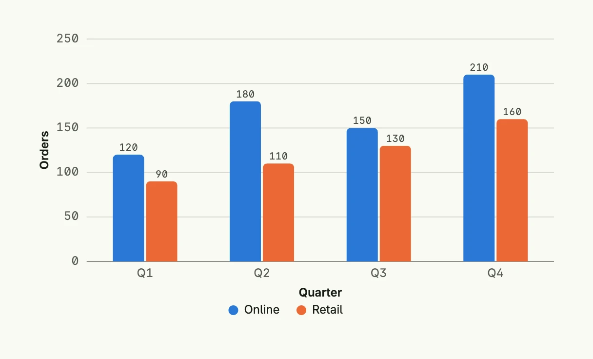
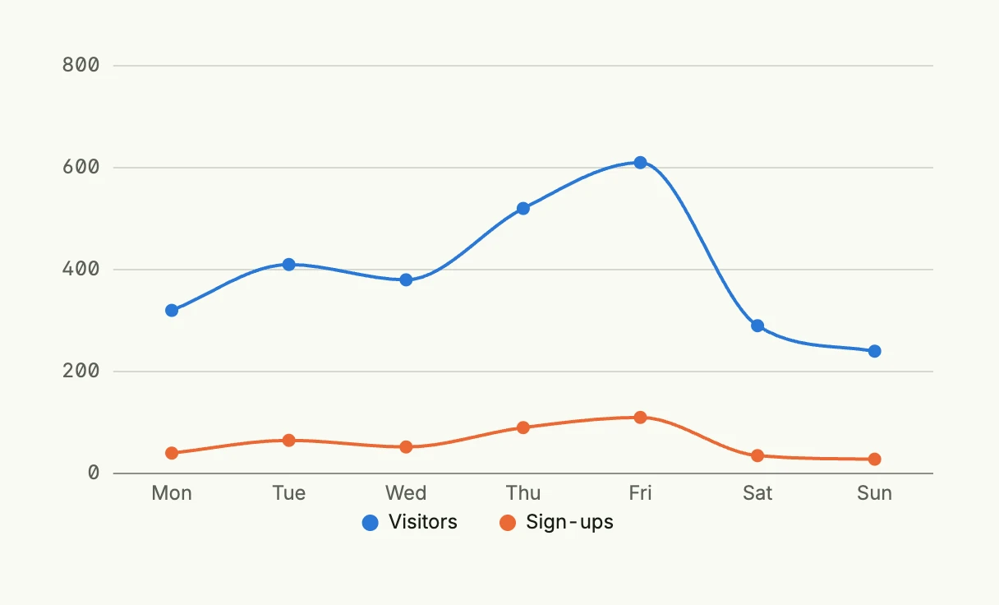
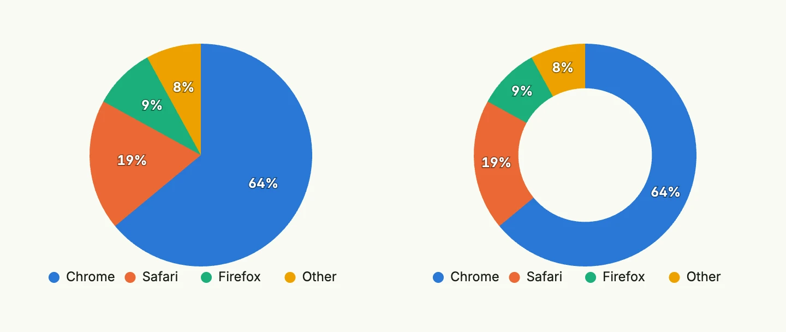

The `svgchart` package renders bar, line and pie charts as static SVG images on the server. It takes the
same `chart.Chart` configuration and `chart.Series` data as the [Bar Chart](../bar_chart/),
[Line Chart](../line_chart/) and [Pie Chart](../pie_chart/) components, but needs no charting library in
the browser: the SVG becomes part of the page, theme colors like `ui.M0` are resolved by the browser and all
text and lines follow the current text color, so the charts work in light and dark mode. Use it for
dashboards, reports and everywhere a dependable, simple chart is more important than animations and
interactive tooltips. Bars, points and slices carry a title, so browsers show the value on hover.



```go
func view(wnd core.Window) core.View {
    series := []chart.Series{
        {
            Label: "Online",
            DataPoints: []chart.DataPoint{
                {X: "Q1", Y: 120}, {X: "Q2", Y: 180}, {X: "Q3", Y: 150}, {X: "Q4", Y: 210},
            },
        },
        {
            Label: "Retail",
            DataPoints: []chart.DataPoint{
                {X: "Q1", Y: 90}, {X: "Q2", Y: 110}, {X: "Q3", Y: 130}, {X: "Q4", Y: 160},
            },
        },
    }

    return svgchart.BarChart(chart.Chart{
        Frame:      Frame{}.Size(L560, L320),
        XAxisTitle: "Quarter",
        YAxisTitle: "Orders",
    }).Series(series)
}
```



```go
func view(wnd core.Window) core.View {
    series := []chart.Series{
        {
            Label: "Visitors",
            DataPoints: []chart.DataPoint{
                {X: "Mon", Y: 320}, {X: "Tue", Y: 410}, {X: "Wed", Y: 380},
                {X: "Thu", Y: 520}, {X: "Fri", Y: 610}, {X: "Sat", Y: 290}, {X: "Sun", Y: 240},
            },
        },
        {
            Label: "Sign-ups",
            DataPoints: []chart.DataPoint{
                {X: "Mon", Y: 40}, {X: "Tue", Y: 65}, {X: "Wed", Y: 52},
                {X: "Thu", Y: 90}, {X: "Fri", Y: 110}, {X: "Sat", Y: 35}, {X: "Sun", Y: 28},
            },
        },
    }

    return svgchart.LineChart(chart.Chart{
        Frame: Frame{}.Size(L560, L320),
    }).Series(series).Curve(svgchart.CurveSmooth).Markers(svgchart.Markers{Size: 4})
}
```



```go
func view(wnd core.Window) core.View {
    series := []chart.Series{
        {
            Label: "Browser",
            DataPoints: []chart.DataPoint{
                {X: "Chrome", Y: 64}, {X: "Safari", Y: 19}, {X: "Firefox", Y: 9}, {X: "Other", Y: 8},
            },
        },
    }

    cfg := chart.Chart{Frame: Frame{}.Size(L320, L256)}

    return HStack(
        svgchart.PieChart(cfg).Series(series),
        svgchart.PieChart(cfg).Series(series).ShowAsDonut(true),
    ).Gap(L32)
}
```

## Configuration

The `chart.Chart` fields work as follows:

| Field | Effect |
|-------|--------|
| `Labels` | The categories of the x-axis. Without labels, the `X` values of the data points are collected in the order of their first appearance. |
| `Colors` | The colors of the series, one per series, repeated if there are more series than colors. Theme colors like `ui.M0` and hex colors are supported. Without colors, a built-in palette is used which is safe for color vision deficiencies. |
| `Frame` | The size of the image. Absolute widths and heights in `dp` or `rem` also define the drawing size, so that text keeps its font size. Without a frame the chart takes the full width and keeps its aspect ratio. |
| `NoDataMessage` | Shown centered, if there are no data points. |
| `XAxisTitle`, `YAxisTitle` | The axis titles. |
| `LabelRounding` | Rounds the values in the data labels and tooltips. |
| `Downloadable` | Ignored, a static image has no toolbar. |

Every chart offers `SVG()`, which returns the markup without rendering it as a view, e.g. to embed the chart
in a PDF or a mail.

## Constructors

```go
func BarChart(chart chart.Chart) TBarChart
func LineChart(chart chart.Chart) TLineChart
func PieChart(chart chart.Chart) TPieChart
```

BarChart creates a new bar chart with default (vertical, non-stacked) configuration and data labels.

LineChart returns a TLineChart initialized with the given chart.

PieChart creates a pie chart with the given chart configuration. Add the data with `Series`.

## Methods

### TBarChart

| Method | Description |
|--------|-------------|
| `Chart(chart chart.Chart) TBarChart` | Chart sets the underlying chart configuration for the bar chart. |
| `Horizontal(horizontal bool) TBarChart` | Horizontal sets whether the bar chart is rendered horizontally. |
| `Markers(markers []Marker) TBarChart` | Markers adds markers to the bar chart to highlight values. Markers are not supported for stacked charts. |
| `Series(series []chart.Series) TBarChart` | Series defines the data series to be displayed in the bar chart. |
| `ShowDataLabels(show bool) TBarChart` | ShowDataLabels shows or hides the values at the end of the bars. Stacked bars show the total of the stack. |
| `Stacked(stacked bool) TBarChart` | Stacked sets whether multiple series are stacked instead of grouped. |
| `SVG() core.SVG` | SVG renders the chart with the default colors for a light theme. |

### TLineChart

A series of type `chart.ChartSeriesTypeArea` fills the area below its line, a series of type
`chart.ChartSeriesTypeColumn` is drawn as bars behind the lines.

| Method | Description |
|--------|-------------|
| `Chart(chart chart.Chart) TLineChart` | Chart sets the chart config. |
| `Curve(curve Curve) TLineChart` | Curve sets the curve style: `CurveStraight`, `CurveSmooth` or `CurveStepline`. |
| `Markers(markers Markers) TLineChart` | Markers sets the markers config, i.e. the radius and the border color of the dots on the data points. |
| `Series(series []chart.Series) TLineChart` | Series sets the data series. |
| `ShowDataLabels(show bool) TLineChart` | ShowDataLabels shows the value above each data point. |
| `SVG() core.SVG` | SVG renders the chart with the default colors for a light theme. |

### TPieChart

Only the first series is rendered, each of its data points becomes a slice.

| Method | Description |
|--------|-------------|
| `Chart(chart chart.Chart) TPieChart` | Chart sets the chart configuration. |
| `Series(series []chart.Series) TPieChart` | Series sets the data series. Only the first series is rendered. |
| `ShowAbsoluteValues(showAbsoluteValues bool) TPieChart` | ShowAbsoluteValues shows the values instead of percentages. |
| `ShowAsDonut(showAsDonut bool) TPieChart` | ShowAsDonut renders a donut instead of a pie. |
| `ShowDataLabels(showDataLabels bool) TPieChart` | ShowDataLabels shows or hides the labels on the slices. |
| `SVG() core.SVG` | SVG renders the chart with the default colors for a light theme. |

## Related

- [Bar Chart](../bar_chart/)
- [Line Chart](../line_chart/)
- [Pie Chart](../pie_chart/)
- [Image](../../basic/image/)
